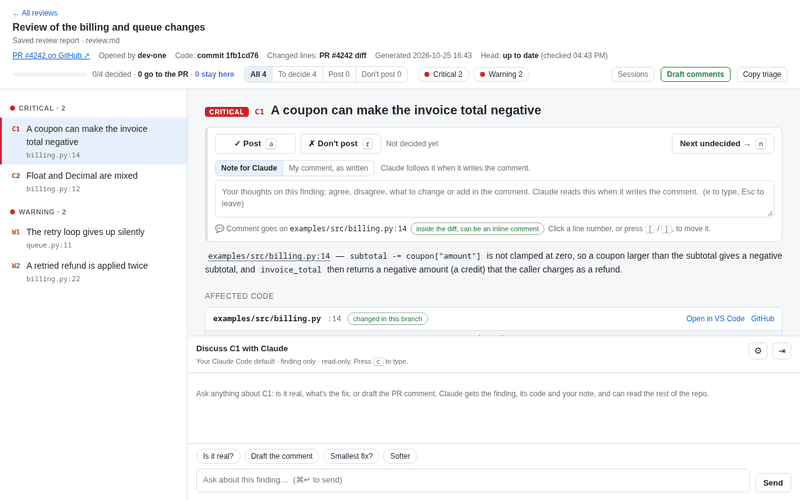
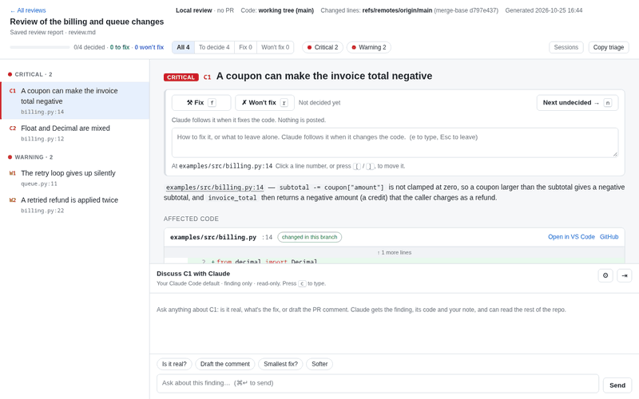
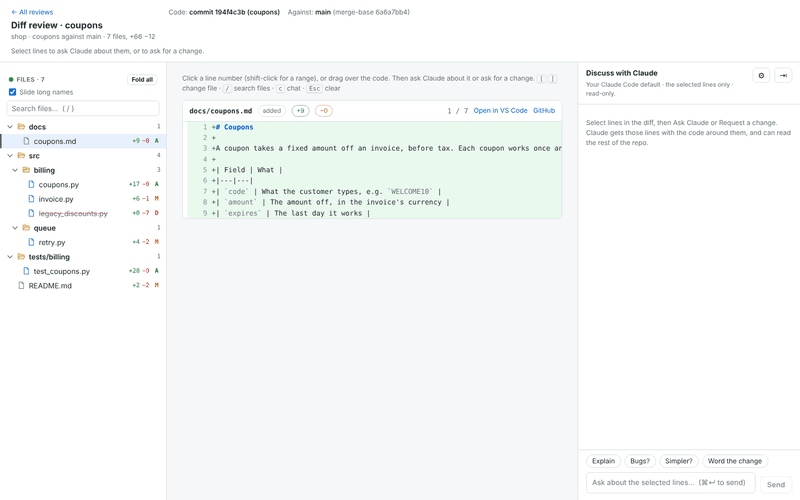

# a-bit-human-review

A local page for the human part of reviewing code that Claude wrote or reviewed, in Claude Code. Two kinds of review,
each with its own page and its own tab in the list:

- **Code review**: when Claude finishes a review, each finding opens beside the code it points at. You mark it **Post**,
  **Fix** or **Don't post**, a fork of the review session drafts the comments you chose, and you edit and post them as
  one GitHub review. Nothing is posted without your approval.
- **Diff review**: before any review that hunts for problems, read every change of your branch yourself, line by line.
  Select lines to ask Claude about them or to request a change, then hand the requested changes back to the session
  that wrote the code.



**Try it without a review of your own** (needs only Python and a browser; Claude is not used):

```sh
FINDING_VIEWER_EXTRACT=0 python3 finding_viewer.py examples/review.md
```

## What it does

| | |
|---|---|
| [Code review of a PR](#code-review) | Triage each finding (post, fix, don't post) with the code beside it, then draft, edit and post the comments as one GitHub review |
| [Code review of your own code](#your-own-code) | No PR: findings are Fix or Won't fix, and **Send fixes to session** hands them back to Claude |
| [Review the new commits](#when-the-pr-moves-on) | When the PR gets new commits, Claude re-reviews them and your triage carries over; findings declined on the PR stay dismissed, and an author's "fixed" is checked against the code |
| [Diff review](#diff-review-read-what-claude-wrote) | `/findings diff`: every change of the branch as one diff, a tree of files with search, threads on lines, change requests sent to the session |
| [Side chat](#the-side-chat) | Discuss any finding or selection with a read-only Claude that can read the repo, or with a fork of the session that wrote the code |
| [The list of reviews](#the-list-of-reviews) | Code reviews and diff reviews in separate tabs, with their triage, what runs on them, PR freshness, Done and Archive |
| [Your own chat buttons](#your-own-chat-buttons) | The quick questions under the chat, per kind of page, from a JSON file |

## Requirements

- macOS or Linux, Python 3.9 or newer (standard library only: nothing to pip install)
- `git`, and the GitHub CLI `gh` logged in (`gh auth login`)
- Claude Code: `claude` on `PATH` or at `~/.local/bin/claude`

## Install

**As a plugin** (recommended). From a terminal (the path of a local clone works in place of
`PolAlcarria/a-bit-human-review`; a relative path must start with `./`):

```sh
claude plugin marketplace add PolAlcarria/a-bit-human-review
claude plugin install a-bit-human-review@a-bit-human-review
```

On Claude Code 2.1.275 or later, `/plugin install a-bit-human-review --marketplace PolAlcarria/a-bit-human-review` inside a
session does both, after asking you to confirm the marketplace and pick a scope. Start a new session (or run
`/reload-plugins`). The command is `/a-bit-human-review:findings`.

**Without plugins.** Clone the repository anywhere and run its installer:

```sh
git clone https://github.com/PolAlcarria/a-bit-human-review ~/tools/a-bit-human-review
python3 ~/tools/a-bit-human-review/finding_viewer.py install
```

It adds two hooks to `~/.claude/settings.json` (keeping the old file as `settings.json.bak`) and the `/findings`
command, all running that clone's `finding_viewer.py`; run it again after moving the clone. `uninstall` removes them.
By hand (quote `<clone>` if it has a space): add this group to the `hooks.Stop` list of `~/.claude/settings.json`, and
the same with `inject` and timeout 10 to `hooks.UserPromptSubmit`:
`{"hooks": [{"type": "command", "command": "python3 <clone>/finding_viewer.py hook", "timeout": 15}]}`.
Then copy `skills/findings/SKILL.md` to `~/.claude/commands/findings.md` with `${CLAUDE_PLUGIN_ROOT}` replaced by
`<clone>`, its `name:` line deleted, and its `env CLAUDE_PLUGIN_DATA=${CLAUDE_PLUGIN_DATA} ` prefix deleted.

Use one way, not both: with the plugin and the manual hooks, every hook runs twice and a review opens twice. Then
**check the setup** with `/a-bit-human-review:findings doctor` (or `/findings doctor`, or `python3 <clone>/finding_viewer.py
doctor`): one PASS / WARN / FAIL line per requirement, the hooks, the command, the server and the settings.

## Commands

`/findings` is `/a-bit-human-review:findings` with the plugin.

| Command | Opens |
|---|---|
| `/findings` | The latest review in this session, else the newest saved report of the repository, else the list |
| `/findings path/to/report.md` | A saved review report |
| `/findings diff [base]` | The diff review of the current branch since its base |
| `/findings list` | The list of all reviews |
| `/findings decisions` | Prints your latest triage |
| `/findings doctor` | Checks the setup |

## Code review

1. Ask for a review and name the viewer: "review PR 123 and open it in the finding viewer". When the turn ends, the
   page opens (or, with `auto_open` off, is built and its address printed). After any review you can also run
   `/findings`. Reviews of a local branch or of the working tree work too, not only PRs.
2. Decide each finding: `a` post, `r` don't post, `e` note, `c` chat, `j`/`k` next/previous. Click a line number to
   choose where the comment goes. Your triage saves as you go.
3. Click **Draft comments**: a fork of the review session, which knows the whole review, writes the comments you chose.
   Edit the drafts, their levels (Must-fix, Should-fix, Suggestion, Nit, Question) and the review type, then
   **Approve & post**. Or write in the review session: your next message carries the triage, and Claude posts only
   what you approved, after your yes.
4. After posting, the review session is told what was posted, so it is not posted twice.

The **Sessions** panel in the toolbar shows what runs on the page (drafting, side chats, a re-review) with Stop, and
the Claude sessions behind it, each with a `claude --resume` command to open it yourself.

### Your own code

With no PR behind it (or on a PR you opened), the page opens in **fix mode**: findings are **Fix** or **Won't fix**,
nothing is posted, and **Send fixes to session** hands the Fix ones to the review session at once. Someone else's PR
opens in **post mode** (Post or Don't post). The header says which; on a page with a PR, **Switch to post** / **Switch
to fix** changes it, and your decisions move with it.



### When the PR moves on

The page checks the PR against the commit it reviewed: up to date, N new commits (and how many findings sit on changed
code), force-pushed, merged or closed, and whether you already approved it. When the PR has new commits, **Review the N
new commits** has a fork of the review session read them: each finding comes back fixed in the new commits, changed or
unchanged, new findings are added, and your triage carries over to the new head. A finding someone on the PR declined
(the change will not be made) comes back **dismissed**, marked Don't post, tagged with who declined it and why, and is
not raised again. Each finding you posted is re-checked with its own thread on the PR and your side chat about it: what
the author answered is checked against the code, so "done" on a finding that still applies shows as **Author says fixed
· still applies** with what is missing, and the thread itself shows under the finding.

## Diff review: read what Claude wrote



`/findings diff [base]` opens every change of the current branch since its base (the repo's base branch, or the one you
name), committed or not, as one diff you read line by line, like a draft PR that does not exist yet. Nothing is sent to
Claude to build it, and nothing is ever posted.

- **Files**: the changed files are a tree of folders that fold (**Fold all** / **Unfold all**, remembered per page),
  one row each, with an icon by kind, the threads on it, `+`/`−` and the status (A, M, D; deleted files struck
  through). A long name keeps its extension in sight and shows whole on hover; **Slide long names** makes cut names
  slide to show their end. The search box (`/`) filters the files by name; Enter opens the first one.
- **Reading**: the hunks with three lines of context, gaps that open 20 lines at a time or whole, and removed lines
  shown where they were. `[` and `]` change file, `c` focuses the chat, `h` hides it, Esc clears the selection.
- **Threads**: click a line number (shift-click for a range) or drag over the code, then **Ask Claude** or **Request a
  change**. A thread is open (a question), **change requested** (your note says what the code should do instead) or
  **resolved**. When Claude words a change in its answer, **Use as change request** makes it your note.
- **Hand-back**: **Send changes to session** gives every requested change, with its lines and note, to the Claude Code
  session the diff was opened from, at once; or write in that session and your next message carries them. **Copy
  requests** copies them as text, for any other chat.
- The page shows the code as it was when you opened it. After Claude changes the code, run `/findings diff` again.

## The side chat

Every finding and every diff thread has its own chat with Claude. It gets the lines with the code around them and your
note, can read the rest of the repository (a worktree of exactly the commit the page shows), and cannot edit or
post anything. In the ⚙ panel, pick the model and the context: the finding or lines only (fast and cheap), or a fork of
the session that wrote the review or the code, so Claude knows why it wrote what it wrote. A drafted comment in an
answer can be used as your note in one click.

## The list of reviews

`/findings list` (or **← All reviews** on any page) opens every stored review, with **Code reviews** and **Diff
reviews** in tabs of their own, each with a count of what is still open. The address keeps the tab (`/#code`,
`/#diff`), and each page links back to its own.

- **Code reviews**: one card per PR (re-renders of the same PR fold under it), with its findings, how many are decided,
  to post or to fix, side chats, what runs now, where the triage went (drafting, drafts ready to approve, posted to
  GitHub, sent to Claude) and the PR's freshness. PRs that are merged, closed or approved by you move to **Done**.
- **Diff reviews**: one card per branch, with its base, files and `+`/`−`, threads, changes requested, resolved and
  open, and whether the changes were sent to Claude.
- **Archive** puts a card away until the PR (or the branch) is reviewed again; **Delete** takes two clicks.

## Your own chat buttons

The buttons under the chat are yours to set. Put `chat-buttons.json` in the data folder (`doctor` prints its path):

```json
{
  "finding": [{"label": "Is it real?", "prompt": "Is this a real problem? Check it against the code."}],
  "diff": [{"label": "Too clever", "prompt": "Is this more complex than it needs to be? Say what I would delete."}]
}
```

`finding` is for a code review's findings, `diff` for the diff review. A kind you leave out keeps the built-in buttons;
`[]` shows none. Up to 12 buttons per kind, a label up to 40 characters, a prompt up to 2000. A click sends the prompt
as your message. `doctor` warns about an entry it had to skip. Reload the page after editing the file. A starting
point is in [examples/chat-buttons.json](examples/chat-buttons.json).

## What it costs and what it touches

- **Reading the findings:** a headless `claude -p` (Sonnet) reads them out of any review format and finds the code
  each one points at: about a minute and $0.10–0.30 per review. Set `extract.enabled` to false to use only the
  built-in parser (markdown findings with `file:line` anchors), or `extract.confirm` to true so that only `/findings`,
  never the Stop hook, starts it. A diff review needs no Claude to build.
- **Draft comments, Review the new commits** and side chats in fork mode resume a fork of the review session, so each
  costs about one more turn of that session. A side chat in its default mode starts a small session that knows only the
  finding, and each later message resumes it.
- **Transcripts it creates** under `~/.claude/projects` (the forks, and a side chat's first session when stopped) are
  deleted once done; `delete_forks` false keeps them.
- **After posting**, the fork tells the review session what was posted (a `claude -p` that may only use
  `SendMessage`), so it is not posted twice. **Send fixes / changes to session** use the same kind of relay.
- **Data** (pages with code excerpts of the reviewed repos, triage, chats, clones and worktrees) lives in
  `~/.local/share/a-bit-human-review`, or for the plugin in `~/.claude/plugins/data/<plugin id>/`, which
  `claude plugin uninstall` deletes unless you pass `--keep-data`. Set `FINDING_VIEWER_DATA` to an absolute path to
  use another folder. The newest 40 pages are kept. The page is served on 127.0.0.1 only.

## Settings

Optional: `config.json` in the data folder, holding only the keys you change, nested as in
`{"extract": {"enabled": false}, "delete_forks": false}`. Each key's environment variable wins over the file. `doctor`
prints the file's path and the effective values.

| Key | Default | Variable | What |
|---|---|---|---|
| `port` | `47321` | `FINDING_VIEWER_PORT` | Port of the local server |
| `repo_dirs` | `[]` | `FINDING_VIEWER_REPO_DIRS` (`:`-separated) | More folders to look in for a local clone of a PR's repository (as `<folder>/<repo name>`), after the session's own folder and the folder beside the session's repository (its parent folder); else `gh repo clone`. Example: `["~/Repos"]` |
| `extract.enabled` | `true` | `FINDING_VIEWER_EXTRACT` (`0` = off) | Let Claude read the findings out of any review format |
| `extract.model` | `sonnet` | `FINDING_VIEWER_EXTRACT_MODEL` | Model that reads them |
| `extract.confirm` | `false` | `FINDING_VIEWER_EXTRACT_CONFIRM` (`1` = on) | On, the Stop hook never starts Claude to read a review: it says so, and `/findings` reads and opens it. A `ReportFindings` review opens as before, since it needs no Claude |
| `draft_model`, `rereview_model` | the session's | `FINDING_VIEWER_DRAFT_MODEL`, `FINDING_VIEWER_REREVIEW_MODEL` | Model of the drafting and re-review forks |
| `chat_model` | Claude's default | `FINDING_VIEWER_CHAT_MODEL` | Side chat model, until you pick one in the page's ⚙ panel |
| `report_glob` | `.claude/.history/code-reviews/*/*.md` | `FINDING_VIEWER_REPORT_GLOB` | Saved review reports, relative to the repository root |
| `default_base` | automatic | `FINDING_VIEWER_DEFAULT_BASE` | Base branch for diffs when there is no PR, and for `/findings diff` (else `origin/HEAD`, develop, main, master) |
| `delete_forks` | `true` | `FINDING_VIEWER_DELETE_FORKS` | Delete the fork transcripts this tool creates |
| `auto_open` | `true` | `FINDING_VIEWER_AUTO_OPEN` (`0` = off) | Open the browser when the Stop hook has a review's page ready. Off, the hook builds the page and tells where it is; `/findings` and the list page still open pages |
| `trigger` | `mention` | `FINDING_VIEWER_TRIGGER` | When the Stop hook opens a page: `mention`, when the prompt names the viewer ("finding viewer", `/findings`); `explicit`, only when the prompt has `/findings` (or `/a-bit-human-review:findings`) written in it; `off`, never, and only `/findings` opens pages |

## More

- [docs/behaviour.md](docs/behaviour.md): how each feature behaves, in detail.
- [docs/ARCHITECTURE.md](docs/ARCHITECTURE.md): processes, modules, data model, job lifecycle, routes, state files.
- [CONTRIBUTING.md](CONTRIBUTING.md): tests, the test server, the rules for changes.
- [CHANGELOG.md](CHANGELOG.md): what changed in each version.
- The GIFs above are recorded by `demo/record.sh [pr] [local] [diff]`, against stubs of Claude and GitHub.
