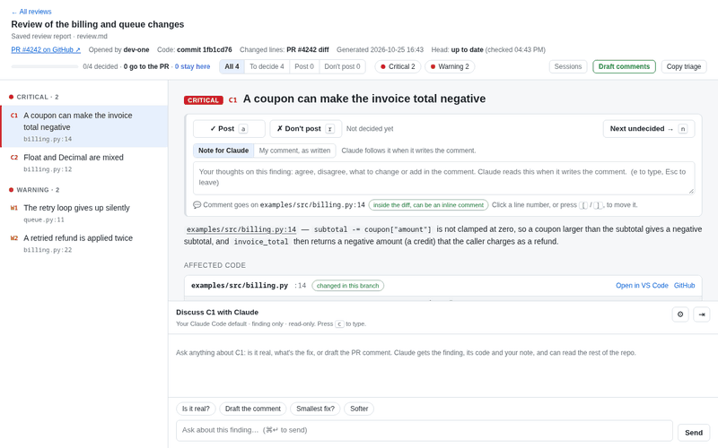
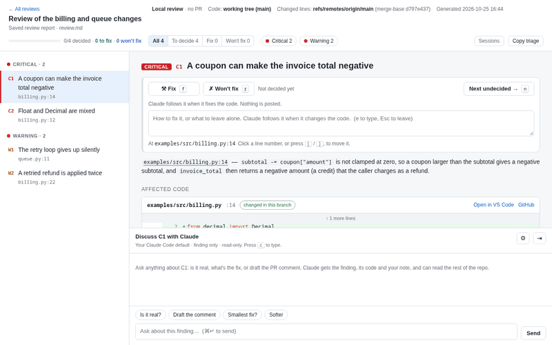

# a-bit-human-review

When Claude finishes a code review in Claude Code, this opens a local page with each finding beside the code it points
at. You mark each one **Post**, **Fix** or **Don't post**, a fork of the review session drafts the comments you chose,
and you edit and post them as one GitHub review. Nothing is posted without your approval.



**Try it without a review of your own** (needs only Python and a browser; Claude is not used):

```sh
FINDING_VIEWER_EXTRACT=0 python3 finding_viewer.py examples/review.md
```

With no PR behind it, the review is of your own code: findings are **Fix** or **Won't fix**, and **Send fixes to
session** hands the Fix ones back to Claude.



## Requirements

- macOS or Linux, Python 3.9 or newer (standard library only: nothing to pip install)
- `git`, and the GitHub CLI `gh` logged in (`gh auth login`)
- Claude Code: `claude` on `PATH` or at `~/.local/bin/claude`

## Install

**As a plugin** (recommended). From a terminal (the path of a local clone works in place of
`PolAlcarria/a-bit-human-review`; a relative path must start with `./`):

```sh
claude plugin marketplace add PolAlcarria/a-bit-human-review
claude plugin install a-bit-human-review@a-bit-human-review
```

On Claude Code 2.1.275 or later, `/plugin install a-bit-human-review --marketplace PolAlcarria/a-bit-human-review` inside a
session does both, after asking you to confirm the marketplace and pick a scope. Start a new session (or run
`/reload-plugins`). The command is `/a-bit-human-review:findings`.

**Without plugins.** Clone the repository anywhere and run its installer:

```sh
git clone https://github.com/PolAlcarria/a-bit-human-review ~/tools/a-bit-human-review
python3 ~/tools/a-bit-human-review/finding_viewer.py install
```

It adds two hooks to `~/.claude/settings.json` (keeping the old file as `settings.json.bak`) and the `/findings`
command, all running that clone's `finding_viewer.py`; run it again after moving the clone. `uninstall` removes them.
By hand (quote `<clone>` if it has a space): add this group to the `hooks.Stop` list of `~/.claude/settings.json`, and
the same with `inject` and timeout 10 to `hooks.UserPromptSubmit`:
`{"hooks": [{"type": "command", "command": "python3 <clone>/finding_viewer.py hook", "timeout": 15}]}`.
Then copy `skills/findings/SKILL.md` to `~/.claude/commands/findings.md` with `${CLAUDE_PLUGIN_ROOT}` replaced by
`<clone>`, its `name:` line deleted, and its `env CLAUDE_PLUGIN_DATA=${CLAUDE_PLUGIN_DATA} ` prefix deleted.

Use one way, not both: with the plugin and the manual hooks, every hook runs twice and a review opens twice. Then
**check the setup** with `/a-bit-human-review:findings doctor` (or `/findings doctor`, or `python3 <clone>/finding_viewer.py
doctor`): one PASS / WARN / FAIL line per requirement, the hooks, the command, the server and the settings.

## First use

1. Ask for a review and name the viewer: "review PR 123 and open it in the finding viewer". When the turn ends, the
   page opens (or, with `auto_open` off, is built and its address printed). After any review you can also run
   `/findings` (`/a-bit-human-review:findings` with the plugin).
2. Decide each finding: `a` post, `f` fix (your own code only: Claude changes the code when you next write in the
   session, and never posts it), `r` don't post, `e` note, `c` chat, `j`/`k` next/previous. Click a line number to
   choose where the comment goes. A review with no PR posts nothing: its findings are `f` fix or `r` won't fix.
3. On a PR review, click **Draft comments**, edit the drafts and their levels, then **Approve & post**. Or write in the
   review session: your next message carries the triage, and Claude posts only what you approved, after your yes.
   On your own code, **Send fixes to session** hands your triage, with its findings marked Fix, to the review
   session at once.
4. When the PR gets new commits, the page offers **Review the N new commits** and carries your triage to the new head.

`/findings list` opens all reviews, `/findings path/to/report.md` a saved report, `/findings decisions` prints your
latest triage. Reviews of a local branch or working tree work too, not only PRs.

## What it costs and what it touches

- **Reading the findings:** a headless `claude -p` (Sonnet) reads them out of any review format and finds the code
  each one points at: about a minute and $0.10–0.30 per review. Set `extract.enabled` to false to use only the
  built-in parser (markdown findings with `file:line` anchors).
- **Draft comments, Review the new commits** and side chats in fork mode resume a fork of the review session, so each
  costs about one more turn of that session. A side chat in its default mode starts a small session that knows only the
  finding, and each later message resumes it.
- **Transcripts it creates** under `~/.claude/projects` (the forks, and a side chat's first session when stopped) are
  deleted once done; `delete_forks` false keeps them.
- **After posting**, the fork tells the review session what was posted (a `claude -p` that may only use
  `SendMessage`), so it is not posted twice.
- **Data** (pages with code excerpts of the reviewed repos, triage, chats, clones and worktrees) lives in
  `~/.local/share/a-bit-human-review`, or for the plugin in `~/.claude/plugins/data/<plugin id>/`, which
  `claude plugin uninstall` deletes unless you pass `--keep-data`. Set `FINDING_VIEWER_DATA` to an absolute path to
  use another folder. The page is served on 127.0.0.1 only.

## Settings

Optional: `config.json` in the data folder, holding only the keys you change, nested as in
`{"extract": {"enabled": false}, "delete_forks": false}`. Each key's environment variable wins over the file. `doctor`
prints the file's path and the effective values.

| Key | Default | Variable | What |
|---|---|---|---|
| `port` | `47321` | `FINDING_VIEWER_PORT` | Port of the local server |
| `repo_dirs` | `[]` | `FINDING_VIEWER_REPO_DIRS` (`:`-separated) | More folders to look in for a local clone of a PR's repository (as `<folder>/<repo name>`), after the session's own folder and the folder beside the session's repository (its parent folder); else `gh repo clone`. Example: `["~/Repos"]` |
| `extract.enabled` | `true` | `FINDING_VIEWER_EXTRACT` (`0` = off) | Let Claude read the findings out of any review format |
| `extract.model` | `sonnet` | `FINDING_VIEWER_EXTRACT_MODEL` | Model that reads them |
| `draft_model`, `rereview_model` | the session's | `FINDING_VIEWER_DRAFT_MODEL`, `FINDING_VIEWER_REREVIEW_MODEL` | Model of the drafting and re-review forks |
| `chat_model` | Claude's default | `FINDING_VIEWER_CHAT_MODEL` | Side chat model, until you pick one in the page's ⚙ panel |
| `report_glob` | `.claude/.history/code-reviews/*/*.md` | `FINDING_VIEWER_REPORT_GLOB` | Saved review reports, relative to the repository root |
| `default_base` | automatic | `FINDING_VIEWER_DEFAULT_BASE` | Base branch for diffs when there is no PR (else `origin/HEAD`, develop, main, master) |
| `delete_forks` | `true` | `FINDING_VIEWER_DELETE_FORKS` | Delete the fork transcripts this tool creates |
| `auto_open` | `true` | `FINDING_VIEWER_AUTO_OPEN` (`0` = off) | Open the browser when the Stop hook has a review's page ready. Off, the hook builds the page and tells where it is; `/findings` and the list page still open pages |

## More

- [docs/ARCHITECTURE.md](docs/ARCHITECTURE.md): processes, modules, data model, job lifecycle, routes, state files.
- [docs/behaviour.md](docs/behaviour.md): how each feature behaves, in detail.
- [CONTRIBUTING.md](CONTRIBUTING.md): tests, the test server, the rules for changes.
